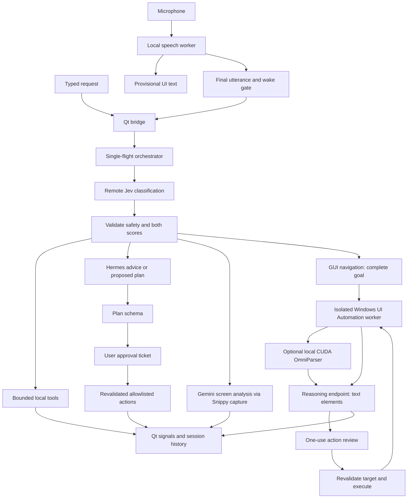

# FLOTER architecture

This document describes the 4.0.0 source, reviewed on 2026-09-27. FLOTER is the product name; `floter` is the import package.

## Components and flow

Experimental GUI navigation adds a Jev `gui_navigate` route: full request → selected visible window → UI Automation observation → optional local OmniParser parsing → JSON action reasoning → single-use review → fresh target validation → input → new observation. The parser runs separately with CUDA; the reasoning endpoint receives text labels. See [GUI_NAVIGATION.md](GUI_NAVIGATION.md).

`app.py` creates the Qt application, frameless window, application icon and QML context. `ui/orb.qml` is the current main view despite its historical filename; `RobotFace.qml` draws the face. `FloterBridge` connects UI signals, audio callbacks, queued speech requests, approvals and history. Worker threads do not directly manipulate QML widgets.

`FloterOrchestrator` admits one task at a time. Typed commands are rejected while busy; the bridge buffers finalized voice commands. It maintains bounded context for Jev, dispatches tools, publishes results, and rejects pending approvals during shutdown.

## Speech lifecycle

`AudioListener` manages cancellable isolated speech work. Faster Whisper loads local weights, probes CUDA in auto mode, and falls back to CPU if necessary. A bounded callback queue keeps capture separate from decoding. Partial transcripts update the UI only. Final decoding after the silence endpoint passes through `WakeSession` before submission. Follow-ups default to 20 seconds. Overflow or excessive utterance length discards audio rather than executing a truncated request. Vosk remains an explicitly selected legacy engine.

## Routing and execution

Jev capability descriptions are assembled from implemented actions and configured app/site allowlists. Every submitted task uses remote classification; there is no local phrase-routing fallback. Most automatic actions require confidence and selected-option probability of at least 0.85. Website/search routes use 0.60. GUI navigation can instead pass on summed GUI-family probability of at least 0.85. Uncertain non-advice decisions return a clarification request without executing; the explicit advice route uses the reasoning provider.

Notepad dictation uses a second Jev call for literal word boundaries with a 0.70 threshold. The extracted argument is a substring of the user's request, validated by a LangChain StructuredTool. The executor verifies the draft/editor identity and reads back appended text. Browser search uses a fixed HTTPS endpoint and a URL-encoded extracted literal topic, falling back to the full request if extraction fails.

Application closing sends normal `WM_CLOSE` to a uniquely identified window and allows save prompts; it does not force-kill processes. Camera work runs in its own Qt process with visible preview, stop/finalization coordination, unique output names and a duration limit. A successful dispatch can precede completion of an ongoing recording; subsequent camera messages report its lifecycle.

## Plans and security boundaries

Hermes produces advice or JSON plans, never executable Python or arbitrary shell commands. `security/plans.py` restricts plans to 1–8 actions: `launch_application` (also supports configured sites), `snippy_capture`, `generate_notepad_document`, `write_notepad`, and `inspect_storage`.

Approval tickets contain a serialized validated plan, expire after 300 seconds, are single-use, and are revalidated when consumed. Saved skills are validated JSON plans and require fresh approval to run. Plans stop on failure; completed external effects are not rolled back.

Trusted executable resolution, allowlists, bounded scans and create-only file helpers are application guardrails, not an operating-system sandbox. A model confidence score does not replace executor validation. Isolated workers support timeouts/cancellation; cancellation cannot retract a completed launch, file write or remote request.

## Data and integrations

| Boundary | Data / behavior |
| --- | --- |
| Local microphone → speech model | Local audio processing; no cloud transcription |
| App → Jev | Final request, routing choices, bounded session context |
| App → Hermes | Escalated request for advice or a proposed plan |
| App → Gemini | Explicit screen-analysis request and screenshot |
| App → GUI reasoning provider | Disclosed window titles and textual accessibility/parser elements; screenshots stay local in this path |
| App → local OmniParser | Authenticated loopback screenshot parsing; separate optional runtime |
| App → Snippy | Configured stdio MCP process or loopback SSE server |
| App → browser | Configured websites or encoded Google query |
| Local disk | Camera media, drafts, saved skills and screenshots |

Configuration uses first-defined dotenv/environment values; see [CONFIGURATION.md](CONFIGURATION.md). User configuration, drafts, skills and startup logs live under `.floter`. Logs/history are session state, not a durable audit database.

## Packaging

Setuptools maps this directory to the `floter` package and includes the three QML views and supplied logo/icon assets. PyInstaller uses `launcher.py`, bundles current documentation, third-party notices, optional local weights and available GPU DLLs. Inno Setup builds a per-user installer; optional signing is configured by environment variables. Wheels and frozen builds must be verified separately from source tests.

For file-by-file walkthroughs and extension guidance, see [codeexplainer.md](codeexplainer.md) and its linked module guides.
